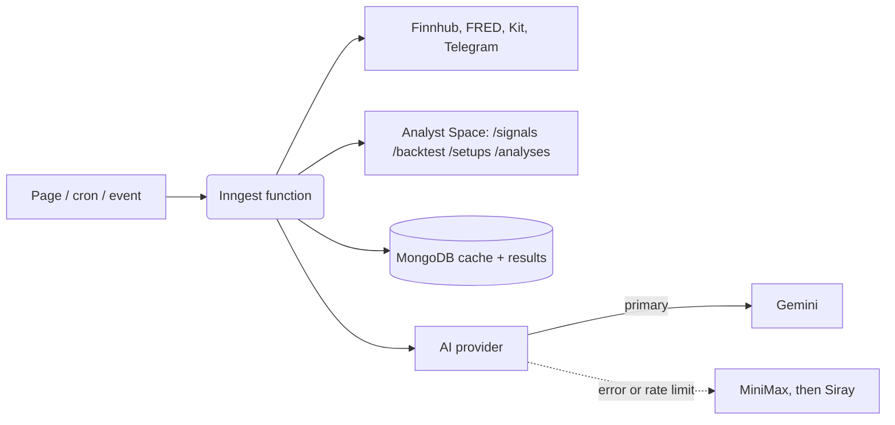

# Tradebook by Nexus: background jobs and integrations

How the app runs behind the scenes. For setup and environment variables see the [README](README.md); the
analyst service has its own guide in [`analyst-service/README.md`](analyst-service/README.md).

## Architecture

The web app (Next.js on Vercel) does the request/response work. Anything slow or scheduled runs as an
**Inngest** function, defined in `lib/inngest/` and registered in `app/api/inngest/route.ts`. Heavy analysis
runs on a separate Hugging Face Space (`analyst-service/`), which Inngest keeps awake.

## Inngest functions

Times are in US Eastern where a time zone is shown, otherwise UTC.

| ID | Trigger | What it does |
|---|---|---|
| `sign-up-email` | event `app/user.created` | AI-written welcome email |
| `weekly-news-summary` | Mon 09:00 UTC, event `app/send.weekly.news` | Summarises top news and sends it as a Kit broadcast |
| `check-stock-alerts` | every 5 min 4 AM–8 PM ET weekdays; every 30 min otherwise (realtime mode only) | Checks price alerts against live quotes and emails the owner |
| `check-inactive-users` | daily 10:00 UTC | Sends a re-engagement email through Kit to users inactive for 30+ days (50 per run, at most one a month each) |
| `keep-analyst-awake` | every 15 min | Pings the analyst and Nexus Spaces so the free tier does not sleep |
| `refresh-market-data` | hourly, event `app/market.refresh` | Earnings calendar, macro snapshot, market data cache |
| `write-market-brief` | 8:50, 12:50, 16:50 ET weekdays, event `app/market.brief` | AI market brief |
| `run-ai-analysis` | event `app/analysis.requested` | One TradingAgents analysis on the analyst Space |
| `run-rl-job` | event `app/rl.requested` | One RL Lab training or scoring job on the Nexus Space |
| `scan-setups` | 16:55 ET weekdays, event `app/setups.scan` | **Strategy 2**: scans every watchlisted symbol, one step per symbol, stores the setup with its 0-100 quant score, and messages opted-in users on entries and exits |
| `telegram-setup` | event `app/telegram.setup` | Registers the Telegram webhook and commands (run once) |
| `telegram-daily-summary` | 16:25 ET weekdays | Watchlist summary |
| `telegram-strategy-signals` | 16:40 ET weekdays | **Strategy 1** (off by default, see `lib/strategies.ts`): messages users when a stock's verdict changes |
| `telegram-earnings` | 8:45 and 17:45 ET weekdays | Earnings reminders and results |

Run any of them by hand from the Inngest dashboard (**Functions > Invoke**) with `{ "data": {} }`.

## Analyst service routes

All routes except `/` need the `X-Analyst-Key` header.

| Route | Strategy | Purpose |
|---|---|---|
| `GET /signals/{ticker}` | Strategy 1 | 10/21 EMA + Supertrend checklist, cached 15 minutes |
| `GET /backtest/{ticker}?years=` | Strategy 1 | Replay of the strategy with risk-adjusted scores |
| `GET /setups/{ticker}?account=&risk_pct=&universe=` | Strategy 2 | Regime-aware breakout state, plan, walk-forward evidence and the 0-100 `quant` score with its breakdown, cached 30 minutes |
| `GET /fundamentals/{ticker}` | | SEC 10-K figures, insider trades, filings |
| `POST /portfolio/optimize` | | Portfolio Lab allocations |
| `POST /analyses`, `GET /analyses/{id}` | | AI Analyst jobs |

## AI providers

`lib/ai-provider.ts` picks the provider from `AI_PROVIDER` (default Gemini). If it fails, the next one is tried:
Gemini falls back to MiniMax (when `MINIMAX_API_KEY` is set) or Siray. If a Gemini model id is retired, older
ids are tried before giving up.

## Integrations

| Service | Used for | Variables |
|---|---|---|
| [Finnhub](https://finnhub.io) | quotes, profiles, news, search | `FINNHUB_API_KEYS` |
| [FRED](https://fred.stlouisfed.org) | economic calendar, yield curve | `FRED_API_KEY` |
| [Kit](https://kit.com) | weekly news broadcast, welcome subscription | `KIT_API_KEY`, `KIT_API_SECRET`, `KIT_WELCOME_FORM_ID` |
| Gmail (Nodemailer) | welcome, price-alert and password-reset emails | `NODEMAILER_EMAIL`, `NODEMAILER_PASSWORD` |
| Telegram Bot API | alerts, summaries, strategy messages | `TELEGRAM_BOT_TOKEN`, `TELEGRAM_WEBHOOK_SECRET` |
| MongoDB Atlas | users, watchlists, alerts, analyses, cache | `MONGODB_URI` |

Tradebook by Nexus is built on [OpenStock](https://github.com/Open-Dev-Society/OpenStock) and is licensed
under AGPL-3.0.
